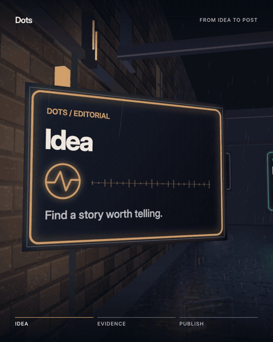

# Event Motion

**One event log. A diagram, a feed, or a rendered video.**

Event Motion is a Flutter package for showing what happened and when. Define your events once, then give each view the same point in time. Play a live workflow, scrub back to a decision, or render the same sequence frame by frame.

<p align="center">
  <a href="docs/media/neon-alley.mp4">
    
  </a>
</p>

**[Watch Neon Alley with sound](docs/media/neon-alley.mp4)** · 18 seconds · 1080 × 1350

Neon Alley is a companion Dots motion study rendered with Three.js and HyperFrames. Its three signs mark the path from an idea to evidence to publication. The Flutter examples below show how to build and render an event sequence with Event Motion.

## Try an example

Clone the repository and run from its root with Flutter 3.44 or newer and FFmpeg on your path.

```sh
git clone https://github.com/moisesaguiarjunior/event_motion.git
cd event_motion
bash tool/render_example.sh agent_pipeline
```

Open `example/build/agent_pipeline/agent_pipeline.mp4` to watch the diagram and activity feed advance on the same clock. The command also exports a PNG cover.

| Example | What it shows | Command |
| --- | --- | --- |
| [Agent pipeline](example/lib/agent_pipeline.dart) | Status changes, moving connections, and an activity feed | `bash tool/render_example.sh agent_pipeline` |
| [Card sequence](example/lib/card_sequence.dart) | Four cards come into focus and settle into a mosaic | `bash tool/render_example.sh card_sequence` |
| Activation | Timed captions and a 1080 × 1350 video. Add a local WAV path to include audio. | `bash tool/render_example.sh activation` |
| Comparison | A vertical PNG with a common scale, ranges, and source notes. The surface can be `paper`, `linen`, or flat. | `bash tool/render_example.sh comparison paper` |

## Use it in Flutter

Add `event_motion` as a [Git or local path dependency](https://dart.dev/tools/pub/dependencies). The library itself depends only on Flutter. The video examples use pinned Fluvie and Handcrafted revisions. See the [compatibility guide](docs/compatibility.md) for supported versions and API scope.

```dart
import 'package:event_motion/event_motion.dart';
import 'package:flutter/widgets.dart';

final diagram = MotionDiagram(
  nodes: const [
    MotionNode('draft', 'Draft', Offset(0, 0.5)),
    MotionNode('review', 'Review', Offset(1, 0.5)),
  ],
  links: const [MotionLink('draft', 'review')],
);

final timeline = MotionTimeline(const [
  MotionEvent(
    at: Duration(seconds: 1),
    from: 'draft',
    node: 'review',
    status: MotionStatus.active,
    message: 'Review started',
  ),
]);

final frame = timeline.at(const Duration(milliseconds: 1300));

final graph = SizedBox(
  width: 360,
  height: 160,
  child: MotionGraph(diagram: diagram, frame: frame),
);
final feed = MotionEventFeed(frame: frame);
```

At 1.3 seconds, the review node is active and a pulse moves along the connection. Change the sample to 0.5 seconds to see the earlier state. Use `frame.statusOf(id)` and `frame.progressSince(start, duration)` to drive your own widget or painter, and pass `nodeBuilder` to customize nodes.

## Render a workflow from JSON

Start with the [example workflow](example/fixtures/agent_pipeline.json). Edit its title, nodes, links, and timed events, then render it as a video and cover.

```sh
bash tool/render_example.sh agent_pipeline ./workflow.json
```

The command writes `workflow.mp4` and `workflow.png` to `example/build/workflow/` by default. Invalid input reports the field to fix. See the [workflow contract](docs/workflow-json.md) and [JSON Schema](example/spec/workflow.v1.schema.json).

To generate a first draft locally, run Ollama with `qwen3.5:4b` installed and pass a text brief:

```sh
bash tool/author_workflow.sh example/fixtures/briefs/newsletter.txt example/build/my-post
```

The command saves an editable JSON spec beside the video and cover. Supply a workflow JSON as the third argument to preserve its event log. See [local authoring](docs/local-authoring.md).

## Explore the editorial tools

```sh
bash tool/render_example.sh editorial_catalog
bash tool/render_example.sh character_poster
bash tool/render_example.sh character_dashboard
```

The catalog highlights eight to twelve illustrated notes and exports the full grid as a cover. The character poster and animated dashboard share one team file. All three use a 1080 × 1350 canvas. See [editorial styles](docs/editorial-styles.md), the [illustration map](docs/mapa-de-ilustracoes.md), and the [Dots editorial workflow](docs/dots-editorial.md).

The [integration guide](docs/integrations.md) covers HyperFrames, Fluvie, and Social Studio. The [Portuguese use-case guide](docs/casos-de-uso.md) covers charts, editorial posts, character motion, and customization.

## Develop

```sh
flutter pub get
flutter analyze
flutter test
(cd example && flutter test)
```

See [architecture](docs/architecture.md), the [roadmap](docs/roadmap.md), and [verification](docs/verification.md).
