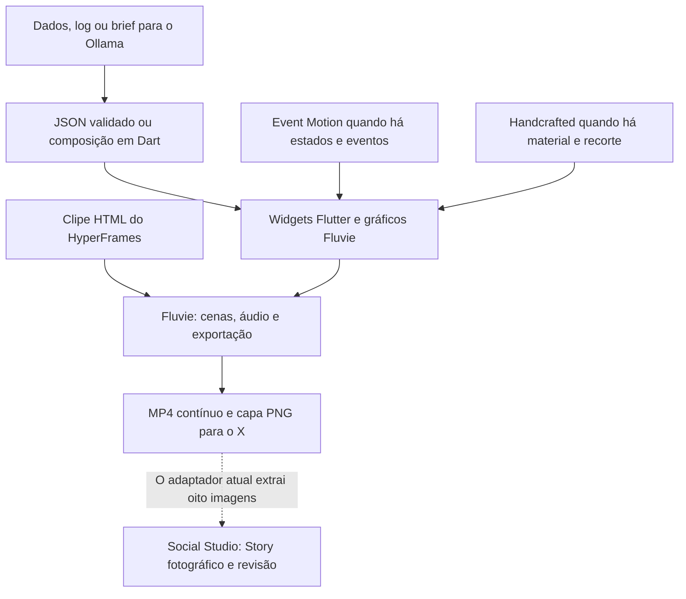

# Casos de uso e customização para posts visuais

Use **Fluvie direto** para gráficos, infográficos e animações que seguem uma sequência de cenas. Acrescente **Event Motion** quando um mesmo histórico de eventos precisa sincronizar nós, cartões, personagens e o feed. Use **Handcrafted** para materiais e formas táteis ou **HyperFrames** quando a cena já vive em HTML. O **Social Studio** vale como etapa opcional de Story e revisão editorial. Para publicar no X, o MP4 contínuo e a capa do Fluvie já são os arquivos de entrega.

## Escolher o caminho pelo conteúdo

| Quero produzir | Comece por | O que posso mudar |
| --- | --- | --- |
| Gráfico de receita, série temporal ou distribuição | `Chart` e `Counter` do Fluvie. Há barras, linha, área, pizza, rosca e dispersão com revelação animada. | Valores, séries, paleta, cores do eixo e da grade, duração da revelação e escalonamento. Adicione rótulos e unidades com `Text` no layout. [Guia de gráficos do Fluvie](https://docs.fluvie.dev/guides/charts-and-data/) |
| Comparativo estático com intervalos, unidade e fonte | Exemplo `comparison` em Flutter, exportado pelo Fluvie. [Comparativo](../example/lib/comparison.dart) | Escolha superfície lisa, papel ou linho pelo comando. Edite valores, intervalos e nota no Dart. |
| Infográfico com sequência de leitura, microdiagramas e capa | Exemplo `editorial_catalog`, com 8 a 12 células. [Documento de exemplo](../example/fixtures/editorial_catalog.json) | Título, texto, ordem de destaque, paleta e diagrama por célula. Os microdiagramas são ilustrativos. Para quantidades reais, use os dados em um `Chart` ou no comparativo. |
| Explicação animada, cartões, abertura ou demo de produto | Texto e widgets Flutter dentro de cenas Fluvie. O exemplo `card_sequence` faz foco, perspectiva e mosaico final. [Cartões](../example/fixtures/cards.json) · [Animações do Fluvie](https://docs.fluvie.dev/guides/animating-elements/) | Configure entrada, saída, atraso, mola, repetição, transição, câmera e quadros-chave. No exemplo, o JSON controla texto, cor e tempos dos quatro cartões. |
| Fluxo de agentes, ativação de bots, etapas em paralelo | Event Motion para a linha do tempo. Use `agent_pipeline` para começar ou `activation` para a composição maior. [Contrato do workflow](workflow-json.md) | Nós, conexões dirigidas, estados, mensagens, duração e capa no JSON. Eventos de nós distintos no mesmo instante permitem ativações simultâneas. |
| Pôster com personagens e painel que ativa equipes | `character_poster` e `character_dashboard` usam o mesmo documento. [Equipe rápida](../example/fixtures/workshop_team_fast.json) | Papéis, notas, formas, cor por personagem, paleta e ordem dos grupos. O modo `fast` dá mais movimento à entrada e encurta os repasses. |
| Tipografia cinética, SVG ou cena existente em HTML | Fluvie para animações de widgets. HyperFrames para composição em HTML/CSS/JS. [Integrações e comandos](integrations.md) | Renderize o HTML como MP4 opaco ou WebM transparente e escolha o ponto de entrada no Fluvie. |
| Story vertical com fotos, áudio e legendas revisáveis | Social Studio desktop. [Job de Story](https://github.com/moisesaguiarjunior/social-studio/blob/b13ecea0d488afbd3f3e26abb6f3c4bbf4a9829c/flutter/social_studio/README.md) | Fotos, ordem, duração por cena, WAV local, legendas e instante de capa. O template artesanal oferece material, recorte e costura. |

## O que cada biblioteca já oferece

### Fluvie para cena, tempo e exportação

Monte um `Video` com `Scene` e widgets Flutter. O Fluvie já tem `Chart`, `Counter`, `Typewriter`, `Image`, `Clip`, `Markdown`, `Mermaid`, `Code`, `Terminal` e anotações como `Callout` e `Spotlight`. Para animar elementos, combine `.animate()`, quadros-chave, `Stagger`, `Repeat` e gatilhos. A composição também aceita música, efeitos sonoros e legendas SRT ou VTT. O Fluvie resolve o tempo das cenas e exporta MP4, GIF, PNGs por quadro ou WebM com transparência no fluxo desktop. `Video.poster` seleciona a capa. [API do Fluvie](https://pub.dev/documentation/fluvie/latest/fluvie/) · [Exportação](https://docs.fluvie.dev/guides/exporting-your-video/)

Para este fluxo local, o CLI e o FFmpeg atendem à entrega. O ecossistema do Fluvie também tem renderização por servidor e encoders próprios para navegador e dispositivos móveis, com suporte que varia por plataforma. [Servidor](https://docs.fluvie.dev/guides/rendering-on-a-server/) · [Navegador](https://docs.fluvie.dev/guides/on-device-web-rendering/) · [Dispositivos móveis](https://docs.fluvie.dev/guides/on-device-mobile-rendering/)

A revelação de um gráfico e a movimentação do widget podem coexistir. `reveal` controla como os dados aparecem. `.animate()` move, escala ou esmaece o gráfico inteiro. Configure as cores dos gráficos com `FluvieTokensScope` e `ChartPalette`, ou use `ChartSeries.color` para uma série específica. `FluvieTheme` é o ponto de partida para tipografia e estilo de uma composição. [Gráficos e customização](https://docs.fluvie.dev/guides/charts-and-data/) · [Temas](https://docs.fluvie.dev/advanced/theming/)

Crie um projeto com `fluvie init`, rode `flutter pub get` e salve o exemplo em `lib/comparativo.dart`. O mapa alimenta as barras e os rótulos. Renderize o vídeo e a capa com `fluvie render ./lib/comparativo.dart --out comparativo.mp4 --poster 2.5s`. [Instalar o CLI](https://docs.fluvie.dev/getting-started/installation/) · [Criar um projeto](https://docs.fluvie.dev/getting-started/start-a-project/)

```dart
import 'package:fluvie/fluvie.dart';
import 'package:flutter/widgets.dart' hide Animation;

const inscricoes = {'Jan': 42, 'Fev': 53, 'Mar': 68, 'Abr': 71};
const texto = Color(0xFFEBF2FE);

Video build() => Video(
  width: 1080,
  height: 1350,
  fps: 24,
  poster: const Time.seconds(2.5),
  scenes: [
    Scene.centered(
      duration: const Time.seconds(3),
      background: Background.color(const Color(0xFF101C2E)),
      child: SizedBox(
        width: 860,
        child: Column(
          mainAxisSize: MainAxisSize.min,
          crossAxisAlignment: CrossAxisAlignment.stretch,
          children: [
            const Text(
              'Inscrições por mês',
              style: TextStyle(
                color: texto,
                fontSize: 64,
                fontWeight: FontWeight.bold,
              ),
            ),
            const SizedBox(height: 32),
            SizedBox(
              height: 420,
              child: FluvieTokensScope(
                tokens: const FluvieTokens(
                  palette: ChartPalette([Color(0xFF68DBB9), Color(0xFFF6BC7B)]),
                  axisColor: Color(0xFF8B9EB7),
                  gridColor: Color(0x334F6A8B),
                  labelColor: texto,
                ),
                child: Chart.bar(
                  data: inscricoes,
                  reveal: const Time.seconds(1.25),
                  stagger: const Stagger.each(Time.frames(4)),
                ).animate([Animation.fadeIn()]),
              ),
            ),
            const SizedBox(height: 16),
            Row(
              children: [
                for (final mes in inscricoes.entries)
                  Expanded(
                    child: Text(
                      '${mes.key}  ${mes.value}',
                      textAlign: TextAlign.center,
                      style: const TextStyle(color: texto, fontSize: 29),
                    ),
                  ),
              ],
            ),
            const SizedBox(height: 36),
            const Text(
              'Dados ilustrativos',
              style: TextStyle(color: Color(0xFFA7B9D1), fontSize: 27),
            ),
          ],
        ),
      ),
    ),
  ],
);
```

### Event Motion para estado compartilhado

O pacote oferece `MotionTimeline`, `MotionFrame`, `MotionDiagram`, `MotionGraph` e `MotionEventFeed`. Passe `nodeBuilder` para trocar o widget de cada nó. Para um layout próprio, consulte `statusOf`, `latestOn` e `progressSince` e desenhe cartões, trilhas ou personagens com widgets e `CustomPainter`. O estado depende do instante consultado, o que permite avançar e voltar na composição. A grade, os personagens e os formatos JSON prontos pertencem aos exemplos. [API pública](compatibility.md) · [Arquitetura](architecture.md) · [CustomPainter](https://api.flutter.dev/flutter/rendering/CustomPainter-class.html)

### Handcrafted para superfície, personagem e traço

`CraftSurface` envolve widgets com papel, tecido ou outros materiais. Em Dart, ajuste `material`, `color`, `seed`, `strength`, `scale` e use `shape` ou `outline` para o recorte. A biblioteca também já oferece pigmento e aquarela, traços desenhados ao longo de caminhos, costura, relevo, iluminação de volume e peças articuladas. É possível passar o progresso do quadro a efeitos como `paintWatercolorSpread`, `trimCraftPath` e `paintCraftStitch`. O pôster usa `CraftSurface` para a textura. As cinco silhuetas, expressões e animações do painel estão no Dart do exemplo. [Blocos do Handcrafted](https://github.com/moisesaguiarjunior/handcrafted_flutter/blob/9eda99d2d4e12b849733b8962a2ebe3b178ff562/README.md#building-blocks) · [Personagens](../example/lib/src/workshop_figure.dart)

### HyperFrames para cenas HTML

Monte a composição no navegador e renderize o clipe separadamente. O adaptador deste repo recebe o mesmo JSON de cartões que o exemplo Flutter. A integração usa MP4 para uma cena opaca e VP9 WebM para um efeito que deixa o fundo Flutter aparecer. Defina FPS, resolução e início do clipe ao encaixar na cena. O adaptador verifica o alpha decodificado no caso transparente. Use os dois renderizadores quando há uma camada HTML concreta para reaproveitar. [Guia do HyperFrames](https://github.com/heygen-com/hyperframes/blob/main/docs/guides/rendering.mdx#transparent-video) · [Comandos](integrations.md)

### Ollama e os dois formatos de autoria

Os comandos `author_workflow.sh` e `author_catalog.sh` usam o Ollama local para produzir os JSONs dos exemplos. O mesmo JSON pode ser editado e renderizado sem outra chamada ao modelo. Se já existe um log de eventos, passe-o ao comando de workflow para preservar nós, conexões, tempos e mensagens e gerar apenas o título e o subtítulo. O próprio ecossistema Fluvie também oferece `fluvie_ai` com Ollama para escrever um `VideoSpec` genérico, que vira `Video` por `buildVideo(spec)`. Escolha o formato de autoria pelo modelo de dados de que a composição precisa. [Autoria neste repo](local-authoring.md) · [Autoria nativa Fluvie](https://docs.fluvie.dev/guides/ai-and-mcp/) · [JSON estruturado no Ollama](https://docs.ollama.com/capabilities/structured-outputs)

## Customizar os exemplos pelo JSON

Copie um arquivo de exemplo para trabalhar. No catálogo, edite `tiles` para a posição visual e `order` para a sequência de destaque. Em cada célula, `diagram` aceita `flow`, `bars`, `curve` ou `orbit` e `accent` aceita `#RRGGBB`. A paleta geral aceita `paper`, `blueprint` ou `rose`. [Esquema do catálogo](../example/spec/catalog.v1.schema.json)

Na equipe, `members` determina a posição dos quatro personagens e cada membro pode ter `color` em hexadecimal. `palette` aceita `forest`, `midnight` ou `aubergine`. Use `groups` para indicar as ativações simultâneas, incluindo cada membro uma vez. O personagem líder coordena todos os grupos. Para duas duplas rápidas, use `"pace": "fast"` e `"groups": [["pauta", "fontes"], ["escrita", "revisao"]]` no documento de exemplo. O palco reserva um balão por lado. Todos os membros ativos mantêm seus próprios sinais e rótulos. [Controles dos exemplos](editorial-styles.md)

```sh
mkdir -p example/build/guia
cp example/fixtures/editorial_catalog.json example/build/guia/catalog.json
cp example/fixtures/workshop_team_fast.json example/build/guia/team.json
# Edite as cópias antes de renderizar.
bash tool/render_example.sh editorial_catalog example/build/guia/catalog.json example/build/guia/grade
bash tool/render_example.sh character_dashboard example/build/guia/team.json example/build/guia/painel
bash tool/render_example.sh character_poster example/build/guia/team.json example/build/guia/poster
bash tool/render_example.sh comparison paper
```

Use o Dart da composição para trocar a grade, inventar uma silhueta, mudar efeitos ou controlar duração e proporção além dos campos disponíveis. Cada capa sai da composição renderizada. Para uma nova proporção, configure o tamanho do `Video` e confira o layout, as margens e o texto no novo quadro. O Fluvie oferece `Adaptive` para variantes de layout por proporção. [Várias proporções no Fluvie](https://docs.fluvie.dev/advanced/multi-aspect/)

## Fluxo da biblioteca até a revisão



No caminho com eventos, monte a `MotionTimeline` com o log e entregue um widget ao Fluvie. O `FrameBuilder` informa o quadro absoluto, o início do escopo e o FPS. O [adaptador do exemplo](../example/lib/src/motion_clock.dart) converte esse quadro em tempo local da cena e consulta `timeline.at(elapsed)`. Diagrama, feed e pintores recebem o mesmo estado. O [renderizador dos exemplos](../example/test/render_example_test.dart) captura pelo Fluvie e codifica com FFmpeg. O CLI nativo do Fluvie também oferece preview e render para uma entrada Dart com `build()`. [FrameBuilder do Fluvie](https://docs.fluvie.dev/advanced/frame-builder/) · [Versões usadas aqui](compatibility.md)

## Quando encaixar o Social Studio

- **Para um post contínuo no X, entregue o MP4 do Fluvie e a capa.** Esse caminho preserva os pulsos, as transições, a cadência original e o áudio da composição.
- **Para um Story fotográfico, use o job atual do Social Studio.** Ele já chama Fluvie internamente e gera MP4, capa, SRT, manifesto e uma página local para navegar por cenas ou legendas. Tem o template fotográfico `story-photo-v1` e o artesanal `story-craft-v1`. O adaptador deste repo transforma quatro segundos do painel em oito fotos de um Story de doze segundos. As trocas seguem os cortes entre fotos. [Integração disponível](integrations.md) · [Template artesanal](https://github.com/moisesaguiarjunior/social-studio/blob/b13ecea0d488afbd3f3e26abb6f3c4bbf4a9829c/docs/crafted-story.md)
- **Para revisar a composição enquanto ela é feita, avalie a revisão nativa do Fluvie.** A documentação atual do projeto descreve `fluvie review` para montar a composição, coletar quadros e inspecionar problemas de texto, tempo e mídia. Esse comando pertence a uma revisão posterior à fixada nos exemplos. O preview do CLI e as pranchas de quadros já cobrem a revisão básica do fluxo atual. [Revisão nativa do Fluvie](https://docs.fluvie.dev/guides/reviewing-a-video/)

Vale ampliar a integração se a equipe quiser a experiência do Social Studio para revisar os vídeos prontos. Nessa evolução, o Social Studio receberia o MP4 original, a capa e, se houver, SRT e marcadores de cena. A revisão usaria o vídeo inteiro e seus tempos. Uma adaptação de formato seria um novo arquivo de entrega. Esse encaixe mantém o Social Studio como consumidor opcional e permite que Event Motion continue sendo usado como widget Flutter em aplicações ou em outros renderizadores.
